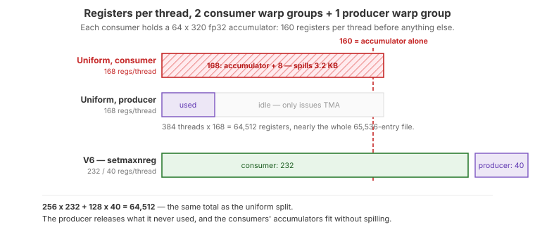

.. _tutorial_hopper_matmul_v6:

6. Register Reallocation, Multicast, and a Persistent Kernel
============================================================

:doc:`V5 <v5>` keeps the tensor cores busy inside each consumer group, but it
still moves more data per FLOP than it needs to, and every CTA pays for its own
pipeline fill and epilogue. The obvious response --- make the tile bigger --- runs
into the constraint that has shaped every version so far: **the accumulator lives
in registers**, and with fp32 accumulation V5's ``128 x 256`` tile already uses half
the register file.

This version keeps V0--V5's fp32 accumulation, so it stays numerically
like-for-like with cuBLAS, and makes four changes:

1. **Register reallocation** with :meth:`~tilus.Script.setmaxnreg`: the producer
   warp group gives up most of its registers so the two consumer groups can hold
   a ``64 x 320`` fp32 accumulator each, for a ``128 x 320`` tile.
2. **A 2-CTA cluster with TMA multicast**: two CTAs that need the same B tile each
   load half of it and multicast it to both, cutting L2 traffic.
3. **A persistent tile loop**: one CTA per SM walks over output tiles, so the
   producer prefetches the next tile while the consumers run the epilogue.
4. **A shared-memory TMA epilogue**, with each consumer group staging its results
   through its own slot for coalesced bulk stores.

Together they take the kernel past cuBLAS on this shape.

The Full Kernel
---------------

.. literalinclude:: ../../../../examples/hopper_matmul/matmul_v6.py
   :language: python
   :start-at: class Pipeline
   :end-before: def main
   :caption: MatmulWGMMAV6 --- full kernel (including Pipeline class)

What Changed from V5
--------------------

.. list-table::
   :header-rows: 1
   :widths: 15 40 40

   * -
     - V5
     - V6
   * - **Output tile**
     - 128 x 256
     - **128 x 320**
   * - **Accumulator dtype**
     - fp32
     - fp32 (unchanged)
   * - **Warp groups**
     - 2 consumers + 1 producer warp
     - 2 consumers + **1 producer warp group**
   * - **Registers per thread**
     - Uniform
     - **232** per consumer thread, **40** per producer thread (``setmaxnreg``)
   * - **WGMMA shape**
     - ``m64n256k16``
     - ``m64n160k16``, two per stage
   * - **Grid**
     - One CTA per output tile
     - **Persistent**: one CTA per SM, in 2-CTA clusters
   * - **B tile loads**
     - Each CTA loads its own
     - Each CTA loads half and **multicasts** it to its cluster peer
   * - **Epilogue**
     - ``store_global`` from registers
     - Staged through shared memory, bulk TMA store
   * - **Pipeline depth**
     - 4 stages
     - 3 stages (the larger tile costs more shared memory per stage)
   * - **New instructions**
     -
     - :meth:`~tilus.Script.setmaxnreg`,
       :meth:`~tilus.Script.store_shared`,
       :meth:`~tilus.lang.instructions.mbarrier.BarrierInstructionGroup.arrive_and_expect_tx_remote`,
       :meth:`~tilus.lang.instructions.tma.TmaInstructionGroup.shared_to_global`,
       :meth:`~tilus.lang.instructions.tma.TmaInstructionGroup.commit_group`,
       :meth:`~tilus.lang.instructions.tma.TmaInstructionGroup.wait_group`

The Register Budget Problem
---------------------------

An accumulator of ``m x n`` distributed over a 128-thread warp group costs
``m * n / 128`` registers per thread in fp32. A wider tile is the most direct way
to move less data per FLOP --- ``128 x 320`` reads 7% fewer operand bytes per FLOP
than ``128 x 256`` --- but each consumer would then hold a ``64 x 320``
accumulator: **160 registers** per thread, before operands, addresses, and loop
state.

The register file is 65,536 registers per SM, and by default every thread of the
CTA gets the same share. With two consumer warp groups and a producer warp group
(384 threads) that share is 168 registers, which the consumers cannot fit into:
compiled at 168, this kernel spills 3.2 KB per thread and runs five times slower.
But the producer only issues TMA loads and needs a few dozen registers.

:meth:`~tilus.Script.setmaxnreg` lets warp groups trade registers at run time
(PTX ``setmaxnreg``). The producer releases down to 40 and the consumers claim
232, which is exactly the same total:

   ``setmaxnreg`` moves registers from the producer warp group to the consumers.
   The total is unchanged; only the split is.

.. literalinclude:: ../../../../examples/hopper_matmul/matmul_v6.py
   :language: python
   :start-at: with self.thread_group(thread_begin=256, num_threads=128):
   :end-at: self.produce(ga, gb, sa, sb, tma_pipe, k_size, num_m_pairs, num_n_blocks)
   :dedent: 8
   :caption: The producer warp group releases registers; one of its warps issues TMA

Each consumer starts with ``self.setmaxnreg(232, "inc")``, which blocks until the
producer's release has made enough registers available. The counts must add up:
if the consumers ask for more than the producer releases, the ``inc`` never
completes and the kernel hangs.

.. important::

   The order of the thread groups in the source matters to ``ptxas``. With the
   producer branch first, ``ptxas`` serializes every WGMMA in the kernel ("wgmma
   serialized due to program dependence on compiler-inserted WG.AR in divergent
   path"), which cost 5% here. Placing the consumer branches first avoids it. The
   branches run concurrently either way, so the order changes nothing else.

The 320 columns are split into two ``m64n160k16`` WGMMAs per stage, because a
WGMMA is at most 256 wide and B is loaded as two 160-row halves (a TMA box is also
at most 256 rows). Both go into one commit group, so V5's ``wait_group(1)``
overlap is unchanged:

.. literalinclude:: ../../../../examples/hopper_matmul/matmul_v6.py
   :language: python
   :start-at: def mma_stage(
   :end-at: self.wgmma.commit_group()
   :dedent: 4
   :caption: One pipeline stage: two 160-wide WGMMA streams

Cluster Multicast
-----------------

Adjacent tiles in M need the same B tile. V6 launches CTAs in clusters of two and
gives the two CTAs of a cluster vertically adjacent tiles. Each loads its own A,
but only **one half** of B, multicast to both CTAs (``multicast_mask=0b11``):

.. literalinclude:: ../../../../examples/hopper_matmul/matmul_v6.py
   :language: python
   :start-at: def produce(
   :end-before: def __call__(
   :dedent: 4
   :caption: Producer: A for this CTA, half of B for both

That cuts each CTA's operand traffic per stage from 448 rows to 288. A multicast
load signals the barrier at the same shared memory offset in every destination
CTA, so each CTA's ``arrive_and_expect_tx`` still expects the whole stage.

The cost is that the pipeline now spans two CTAs. A producer may refill a stage
only once **both** CTAs' consumers have finished with it, because its multicast
writes into its peer's shared memory too. Each consumer therefore releases a stage
to both CTAs, and the empty barriers count four arrivals:

.. literalinclude:: ../../../../examples/hopper_matmul/matmul_v6.py
   :language: python
   :start-at: def release_stage
   :end-before: def mma_stage(
   :dedent: 4
   :caption: Releasing a stage to both producers of the cluster

.. note::

   ``sem="relaxed"`` matters. The default ``release`` semantics at cluster scope
   made each arrive wait for prior memory operations to become visible cluster
   wide, which made the kernel twice as slow. The consumer only reads the stage, and
   its WGMMA reads have completed by the time it arrives, so there is nothing to
   publish.

``self.cluster.sync()`` brackets the kernel: before the first multicast, so the
peer's barriers exist, and at the end, so neither CTA exits while the other may
still write into its shared memory.

Persistent Tile Loop
--------------------

V0--V5 launch one CTA per output tile. Each CTA fills the pipeline, computes, runs
its epilogue, and exits, and the tensor cores idle through the fill. V6 launches
**one CTA per SM** and loops over tiles instead. Both CTAs of a cluster walk the
same sequence of tile pairs, which keeps their multicasts in lockstep:

.. literalinclude:: ../../../../examples/hopper_matmul/matmul_v6.py
   :language: python
   :start-at: def tile_offsets
   :end-before: def release_stage
   :dedent: 4
   :caption: Mapping a tile-pair index to this CTA's tile

The ``Pipeline`` stage and phase simply carry over from one tile to the next. The
producer runs ahead into the next tile's loads as soon as stages free up, so by
the time the consumers finish an epilogue, the next tile's first stages are
already in shared memory.

Shared-Memory Epilogue
----------------------

Each consumer writes its ``64 x 320`` result through shared memory and a bulk TMA
store rather than per-thread ``store_global``. A full staging buffer for both
groups would be 80 KB on top of the 168 KB ring buffer, past the 228 KB budget, so
each group gets one ``64 x 160`` slot and stages its two halves in turn:

.. literalinclude:: ../../../../examples/hopper_matmul/matmul_v6.py
   :language: python
   :start-at: # Epilogue: each group stages
   :end-at: self.store_half(sc[consumer_idx], gc, acc1, row, offset_n + half_n)
   :dedent: 12
   :caption: Consumer epilogue

.. literalinclude:: ../../../../examples/hopper_matmul/matmul_v6.py
   :language: python
   :start-at: def store_half(
   :end-before: def consume(
   :dedent: 4
   :caption: Staging one half and issuing its TMA store

Because each group has its own slot, the two groups never wait on each other. The
only wait is ``tma.wait_group(n=0, read=True)`` before a slot is rewritten, and it
waits only for the TMA engine to finish **reading** shared memory, not for the
global writes to land.

.. important::

   The :meth:`fence.proxy_async(space="shared") <tilus.lang.instructions.fence.FenceInstructionGroup.proxy_async>`
   is not optional. :meth:`~tilus.Script.store_shared` writes through the
   **generic proxy**, while
   :meth:`tma.shared_to_global() <tilus.lang.instructions.tma.TmaInstructionGroup.shared_to_global>`
   reads through the **async proxy** used by the TMA engine. Without a
   ``fence.proxy.async.shared::cta`` between them, the TMA engine may read stale
   data.

.. note::

   An earlier version of this tutorial took a different route to a larger tile:
   it accumulated in **fp16** (``wgmma.mma_async...f16.f16.f16``), which halves the
   accumulator and fits a ``256 x 256`` tile without register reallocation. That
   kernel ran at 1.37 ms, but cuBLAS accumulates in fp32, so the comparison was not
   like-for-like, and the precision cost was real: over a K=8192 reduction with
   unit-variance outputs, the mean absolute error rose from 0.00014 to 0.0023, and
   the maximum reached 0.047.

Performance
-----------

V6 reaches **756 TFLOPS** (1.455 ms) against cuBLAS at 752 TFLOPS (1.463 ms) ---
**101% of cuBLAS**, and 10% ahead of V5. Against the cuBLAS timing taken in the
same process, V6 wins every run:

.. list-table::
   :header-rows: 1
   :widths: 12 20 20 24

   * - Run
     - V6
     - cuBLAS
     - V6 / cuBLAS
   * - 1
     - 1.4548 ms
     - 1.4697 ms
     - 101.0%
   * - 2
     - 1.4602 ms
     - 1.4632 ms
     - 100.2%
   * - 3
     - 1.4482 ms
     - 1.4616 ms
     - 100.9%

The margin is small, and both kernels vary by 1--2% run to run, so quote the range
rather than a single run. That the two are this close is not a coincidence:
cuBLAS's kernel for this shape, ``nvjet_sm90_hsh_320x128_64x3_1x2``, is a 320 x
128 tile with ``block_k`` 64, 3 stages, and a 1 x 2 cluster, launched at 168
registers per thread --- the same design. Under Nsight Compute, V6's tensor pipe
is active 97.9% of active cycles against cuBLAS's 97.1%, and V6 finishes in
1.548 ms against 1.560 ms at the profiler's pinned clock.

Both kernels also share the same remaining loss: 1,664 tiles over 132 SMs is 12.6
rounds, so the last round runs with 40% of the SMs idle.

.. warning::

   The ratio is also sensitive to how long the timed window is, because an
   8192\ :sup:`3` fp16 GEMM saturates the board's power budget. At 100 timed
   iterations instead of this tutorial's 30, the H100 throttles partway through
   the window. The benchmark script takes a 3-second cooldown before every
   measurement, cuBLAS included, and exposes ``--repeat`` so this can be checked
   directly. Run it on an idle GPU.

The complete source is at :github:`examples/hopper_matmul/matmul_v6.py`.

.. plot:: tutorials/matmul-hopper/plots/plot_v6.py

   Hopper matmul performance on H100 SXM (M=N=K=8192, fp16). Latency is
   CUDA-event timed, median of three fresh processes. Peak is the published
   dense FP16 tensor core throughput of the H100 SXM.

Summary
-------

Starting from a minimal TMA-fed kernel that pushed every operand through the
register file (V0), we replaced the MMA path with Hopper's asynchronous
shared-memory WGMMA (V1), overlapped loading and computing with a multi-stage
ring buffer (V2), separated the two into dedicated producer and consumer warps
(V3), doubled the independent MMA streams and factored the bookkeeping into a
``Pipeline`` class (V4), kept a WGMMA group permanently in flight (V5), and
finally rebalanced the register file for a ``128 x 320`` tile, shared B across a
2-CTA cluster, and made the kernel persistent (V6).

Two themes run through the whole series. The first is that Hopper's engines ---
TMA, the tensor cores, and the SM's own instruction issue --- are independent, and
performance comes from arranging for all of them to have work queued at all
times. The second is that the register file is the binding constraint on how
large a tile a Hopper kernel can hold, which is why the final step had to move
registers from the warp group that does not need them to the ones that do.

.. caution::

   The result reported here is specific to this shape (M=N=K=8192), dtype
   (fp16 inputs and outputs, fp32 accumulation), GPU (H100 SXM), and benchmark
   methodology. It is not a claim about other GEMM shapes: at 4096\ :sup:`3`, for
   example, the 320-wide tile leaves the last of only four rounds mostly idle, and
   V6 trails cuBLAS. The autotune spaces checked into the examples are pinned to a
   single configuration each, tuned for exactly this workload.
